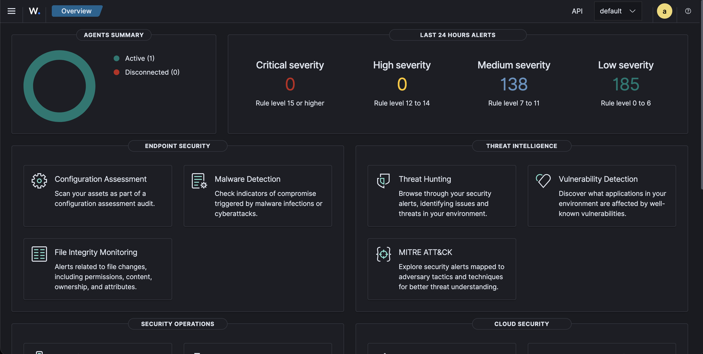
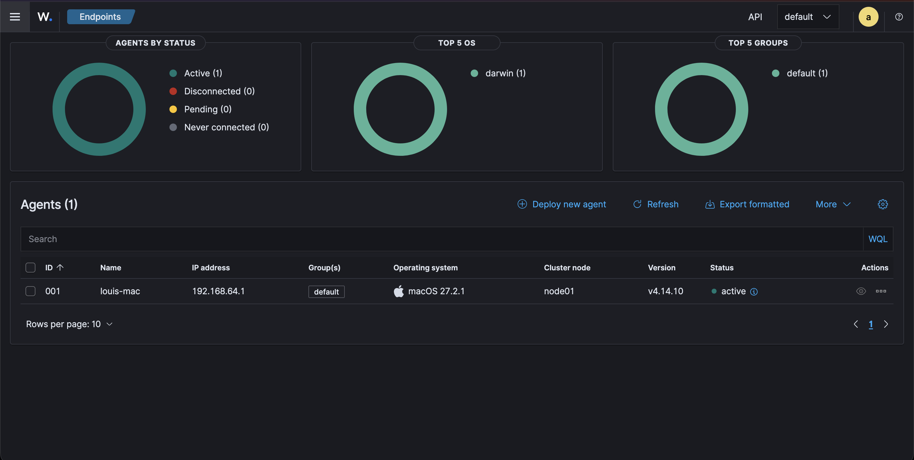

# SOC Home Lab on a MacBook Air (Wazuh SIEM)

A personal Security Operations Center (SOC) home lab built on an Apple Silicon MacBook Air. It runs the open-source **Wazuh** SIEM/XDR platform inside an Ubuntu Server virtual machine and monitors the host Mac through a Wazuh agent.

## What this lab does

- Collects security events from my Mac and the Wazuh server itself
- Shows alerts by severity (critical, high, medium, low) on a web dashboard
- Supports configuration assessment, file integrity monitoring, malware detection, vulnerability detection, and MITRE ATT&CK mapping

## Lab architecture

```
+--------------------------------------------------+
|  MacBook Air (Apple M4, 16 GB RAM)               |
|                                                  |
|   Wazuh agent: "louis-mac"  ---------+           |
|                                      |           |
|   +----------------------------------v-------+   |
|   |  UTM virtual machine: SOC-Wazuh          |   |
|   |  Ubuntu Server 24.04 LTS (ARM64)         |   |
|   |  4 CPU cores / 8 GB RAM / 64 GB disk     |   |
|   |                                          |   |
|   |  Wazuh 4.14 (all-in-one):                |   |
|   |   - Wazuh manager (server)               |   |
|   |   - Wazuh indexer                        |   |
|   |   - Wazuh dashboard (https, port 443)    |   |
|   +------------------------------------------+   |
+--------------------------------------------------+
```

## Tools used

| Tool | Purpose |
|------|---------|
| UTM (QEMU) | Runs the virtual machine on Apple Silicon |
| Ubuntu Server 24.04 LTS (ARM64) | Operating system for the SOC server |
| Wazuh 4.14 | SIEM / XDR: manager, indexer, dashboard |
| Wazuh agent 4.14 (macOS, Apple Silicon) | Sends Mac security events to the server |
| OpenSSH | Remote management of the server from macOS Terminal |

## How I built it

1. **Created the VM** in UTM: Virtualize > Linux, 8 GB RAM, 4 CPU cores, 64 GB disk, booted from the Ubuntu Server 24.04 ARM64 ISO.
2. **Installed Ubuntu Server**: used the entire disk (LVM turned off so the full disk is usable), enabled the OpenSSH server.
3. **Updated the system** over SSH from my Mac:
   ```bash
   sudo apt update && sudo apt upgrade -y
   sudo reboot
   ```
4. **Installed Wazuh** with the official all-in-one installation assistant:
   ```bash
   curl -sO https://packages.wazuh.com/4.14/wazuh-install.sh && sudo bash ./wazuh-install.sh -a
   ```
5. **Logged in to the dashboard** at `https://<server-ip>` as `admin`.
6. **Deployed a Wazuh agent on macOS** (Apple Silicon) from the dashboard's "Deploy new agent" page, then started it:
   ```bash
   sudo /Library/Ossec/bin/wazuh-control start
   ```
7. **Confirmed the agent is Active** under Endpoints.

## Screenshots

<!-- Upload your screenshots to the "screenshots" folder and they will show here -->

| Dashboard overview | Active agent |
|---|---|
|  |  |

## What I learned

- How to run Linux virtual machines on Apple Silicon with UTM
- Installing and administering Ubuntu Server over SSH
- Deploying a SIEM (Wazuh manager, indexer, dashboard)
- Enrolling endpoints with agents and checking their status
- Reading alerts by severity level

## Next steps

- [ ] Simulate failed SSH logins (brute force) and investigate the alerts
- [ ] Test File Integrity Monitoring by changing a watched file
- [ ] Explore MITRE ATT&CK mappings for generated alerts
- [ ] Add a second endpoint (Linux or Windows VM)
- [ ] Connect alerts to my Ghost Mesh SOC ticket system
